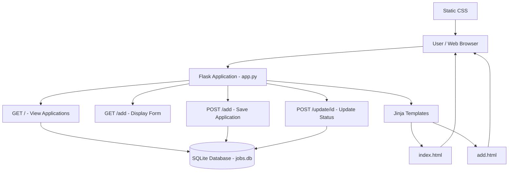

Job Application Tracker

A web-based job application tracking system built using **Python, Flask and SQLite**. The application allows users to record job applications, view submitted applications and update their application status through a simple interface.

Features

- Add job applications with company name, job role and application date.
- View and manage saved job applications.
- Update application status across four stages: Applied, Interview, Rejected and Offered.
- Store application records in an SQLite database.
- Run the application inside a Docker container.
- GitHub Actions workflow for automated application checks.

Application Architecture

The application follows a simple Flask-based architecture with SQLite for data persistence.

Technology Stack

